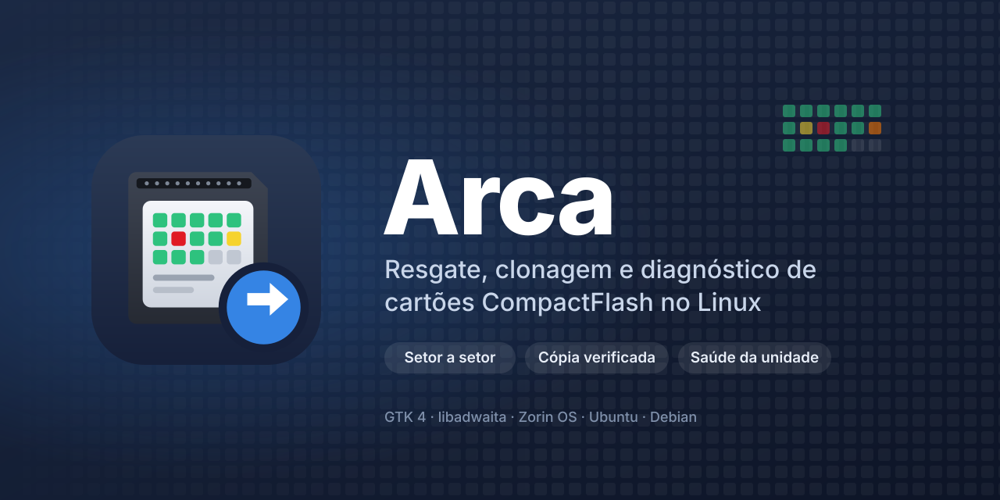
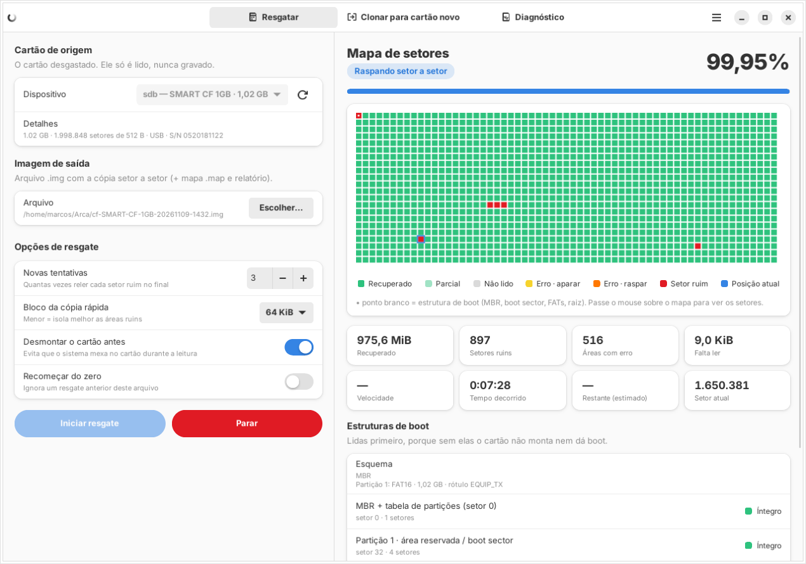
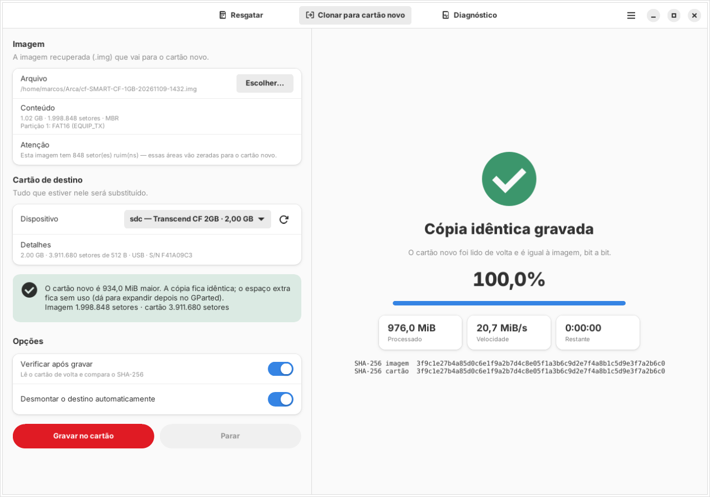
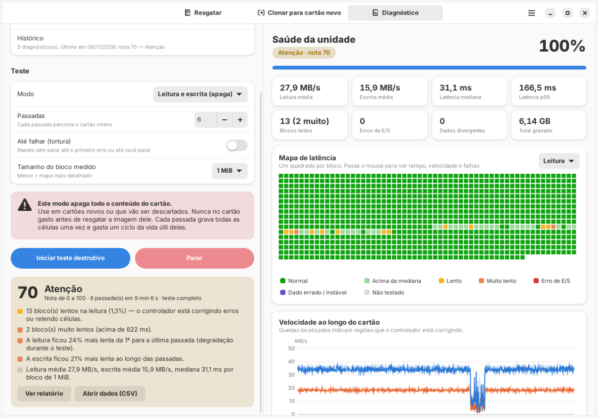
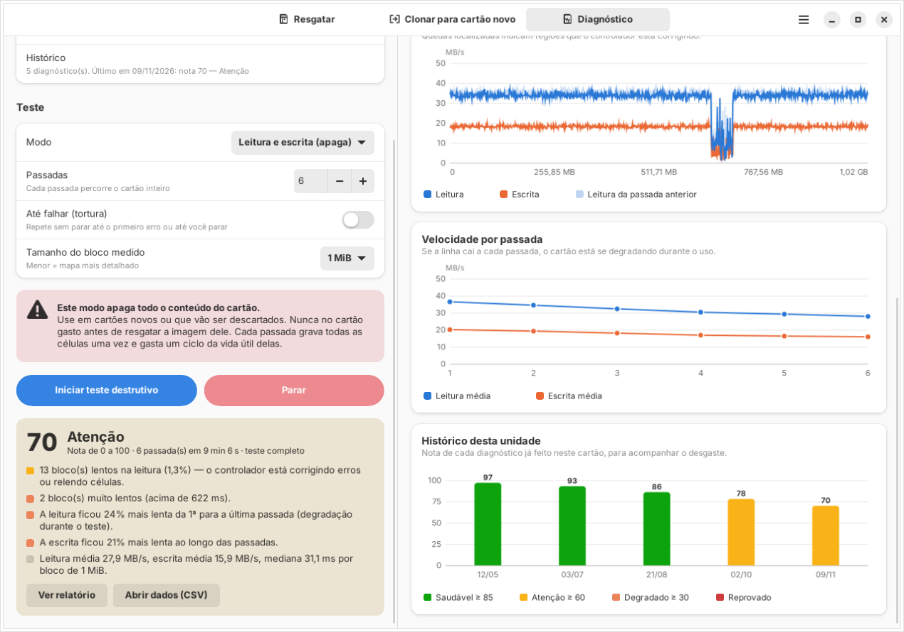

<p align="center">
  
</p>

<p align="center">
  
  
  
  
  
</p>

**Arca** é um programa para Linux que **resgata setor a setor** cartões CompactFlash que estão morrendo, **clona** a imagem para um cartão novo com verificação bit a bit e faz o **diagnóstico de saúde** de qualquer cartão: velocidade, latência de cada bloco, corrupção, leitura instável, capacidade falsa e a degradação de um teste para o outro.

Nasceu de uma necessidade real: vários cartões CF que guardam sistemas de equipamentos começaram a falhar com o tempo, com setores que deixam de ler e cartões que somem do leitor. Copiar com `dd` para no primeiro erro, e o `ddrescue` não mostra o que está acontecendo nem diz se o cartão novo é confiável. A Arca junta as três coisas numa interface só: tira do cartão tudo o que ainda dá para ler, grava uma cópia idêntica e mede se a unidade aguenta o serviço.

<p align="center">
  <br>
  <sub>Resgate de um CF de 1 GB com áreas danificadas: mapa de setores ao vivo e estruturas de boot lidas primeiro (cartão simulado no laboratório de testes do projeto).</sub>
</p>

---

## O que ela faz

### 1. Resgatar

Copia o cartão para um arquivo `.img`, setor a setor, sem nunca gravar nele.

- **Estruturas de boot primeiro:** MBR e tabela de partições, boot sector, as duas FATs e o diretório raiz. Sem elas o cartão não monta nem dá boot, então elas são lidas antes de tudo e resolvidas setor a setor. Cada uma aparece na tela como *Íntegro* ou *Com setores ruins*.
- **Várias passadas**, na mesma estratégia do GNU ddrescue:

  | Passada | O que faz |
  |---|---|
  | Cópia rápida | Lê em blocos e **pula** as áreas com erro, para pegar o máximo de dados bons antes que o cartão piore |
  | Cópia reversa | Volta pelo que foi pulado, de trás para frente |
  | Aparar | Lê setor a setor as bordas de cada área com erro |
  | Raspar | Lê setor a setor o miolo das áreas com erro |
  | Novas tentativas | Relê os setores ruins N vezes, alternando a direção |

- **Leitura direta** (`O_DIRECT`, sem cache do kernel), read-ahead desligado e timeout SCSI reduzido durante o resgate; tudo é restaurado no final.
- **Retomável:** o mapa é salvo o tempo todo (`.map`, **compatível com o GNU ddrescue**). Se o cartão desconectar ou você fechar o programa, clique em **Retomar**.
- **Relatório** (`.relatorio.txt`) com os setores ruins, o estado de cada estrutura de boot e o SHA-256 da imagem.

### 2. Clonar para cartão novo

<p align="center">
  
</p>

- **Confere se cabe.** Cartões de mesma capacidade nominal ("1 GB") quase sempre têm números de setores diferentes entre marcas. A Arca compara o tamanho exato e aceita um cartão um pouco menor **se todas as partições couberem**.
- **Verifica a cópia:** lê o cartão novo de volta e compara o SHA-256 com a imagem. Se bater, a cópia é idêntica bit a bit.
- **Proteções:** recusa gravar no disco do sistema e pede para digitar o nome do dispositivo (`sdc`, por exemplo) antes de apagar.

### 3. Diagnóstico da unidade

<p align="center">
  
</p>

Dois modos:

| Modo | O que faz | Altera o cartão? |
|---|---|---|
| **Só leitura** | Lê o cartão inteiro N vezes, mede cada bloco e compara o CRC entre as passadas | Não |
| **Leitura e escrita** | Grava o cartão inteiro com um padrão diferente por passada (aleatório, `0x55`, `0xAA`, `0xFF`, `0x00`), lê tudo de volta e confere | **Sim, apaga tudo** |

Há também o modo **Até falhar (tortura)**: repete as passadas sem parar até aparecer o primeiro erro, para descobrir quanto o cartão aguenta.

Cada setor gravado leva um carimbo com o próprio endereço. Com isso o teste detecta:

| Problema | Como aparece |
|---|---|
| Bits corrompidos | o dado lido é diferente do gravado |
| Escrita perdida | o cartão aceitou a escrita, mas manteve o dado antigo |
| Capacidade falsa | o setor gravado reaparece em outro endereço (cartão que diz ter mais espaço do que tem) |
| Leitura instável | o mesmo bloco devolve dados diferentes a cada leitura (células fracas) |
| Blocos lentos | latência muito acima da mediana: o controlador está corrigindo erros ou relendo células |
| Degradação no uso | a velocidade cai de uma passada para a outra |

<p align="center">
  <br>
  <sub>Um CF de 1 GB com uma região desgastada: a queda no meio do gráfico de velocidade, a perda de 24% entre a 1ª e a 6ª passada e a nota caindo teste após teste (cartão simulado).</sub>
</p>

No fim sai uma **nota de 0 a 100** com a explicação de cada desconto:

| Nota | Veredito |
|---|---|
| 85 – 100 | **Saudável** |
| 60 – 84 | **Atenção** — funcionando, mas com sinais de desgaste |
| 30 – 59 | **Degradado** — trocar em breve |
| 0 – 29 | **Reprovado** — erros de E/S, dados corrompidos ou cartão que parou de responder |
| 0 | **Falsificado** — capacidade falsa |

Cada diagnóstico fica no **histórico da unidade** (identificada pelo número de série), para acompanhar o desgaste do mesmo cartão ao longo dos meses. O teste também gera um relatório `.txt` e um `.csv` com a latência de cada bloco, para analisar em planilha.

## Instalação

Requisitos: Zorin OS 17 ou 18 (ou Ubuntu 22.04+ / Debian 12+), Python 3.10+, GTK 4 e libadwaita.

**Pacote .deb (recomendado):** baixe o `arca_x.y.z_all.deb` em [Releases](https://github.com/aragonxpd154/arca/releases/latest) e instale com dois cliques ou com:
```bash
sudo apt install ./arca_1.1.0_all.deb
```

**Pelo código-fonte:**
```bash
git clone https://github.com/aragonxpd154/arca.git
cd arca
./install.sh
```

Depois da instalação, a Arca aparece com o logo no menu de aplicativos e ganha um atalho na Área de Trabalho. Se o Zorin mostrar um aviso no atalho, clique com o botão direito e escolha **Permitir execução** (só na primeira vez).

Para remover: `sudo apt remove arca` (ou `./uninstall.sh`). As imagens e relatórios em `~/Arca` não são apagados.

**Rodar sem instalar** (para desenvolver):
```bash
sudo apt install python3-gi gir1.2-gtk-4.0 gir1.2-adw-1 librsvg2-common
python3 -m arca
```

## Como usar

1. Coloque o cartão gasto no leitor USB. Na aba **Resgatar** ele aparece sozinho na lista.
2. Confira onde a imagem será salva (padrão: `~/Arca/`) e clique em **Iniciar resgate**. O sistema pede a senha de administrador uma vez.
3. Ao terminar, clique em **Gravar em outro cartão**, troque pelo cartão novo, confira o aviso de tamanho e clique em **Gravar no cartão**.
4. Antes de confiar no cartão novo, rode um **Diagnóstico** de leitura e escrita nele. Depois do resgate, se quiser, rode um diagnóstico **só de leitura** no cartão velho para registrar o estado dele.

### Linha de comando

O mesmo motor funciona no terminal (útil por SSH ou em servidor):
```bash
sudo /usr/libexec/arca/arca-worker --texto listar
sudo /usr/libexec/arca/arca-worker --texto resgatar /dev/sdb ~/Arca/cartao.img --tentativas 5
sudo /usr/libexec/arca/arca-worker --texto gravar ~/Arca/cartao.img /dev/sdc
sudo /usr/libexec/arca/arca-worker --texto diagnosticar /dev/sdc --modo leitura --passadas 3
sudo /usr/libexec/arca/arca-worker --texto diagnosticar /dev/sdc --modo escrita --passadas 10 --confirmo-apagar
```

## Dicas para cartões que estão morrendo

- **Resgate primeiro, sempre.** Não rode fsck, chkdsk nem o diagnóstico de escrita no cartão original: tudo isso grava nele e pode destruir o que ainda dá para ler.
- Comece com poucas tentativas (3). Se sobrarem setores ruins, rode de novo com mais; a Arca só relê o que faltou.
- Se o leitor USB travar ou o cartão sumir do sistema, reconecte e clique em **Retomar**. Às vezes trocar de leitor ou de porta USB recupera setores que antes falhavam.
- Setores ruins vão zerados para o cartão novo. O relatório diz se eles caíram numa estrutura de boot (grave) ou só na área de dados.
- Guarde o `.img`: ele é o backup do cartão. Dá para gravar quantas cópias quiser.
- O teste de escrita gasta vida útil: cada passada grava todas as células uma vez. Cartões industriais SLC aguentam muitos ciclos; cartões comuns, bem menos. Use o modo tortura só em cartões de teste.
- Cartões CF industriais usam o modo True IDE. Num leitor USB comum aparecem como `/dev/sdX`; num adaptador CF-IDE/SATA também funcionam.

## Estrutura do projeto

```
arca/
├── arca/
│   ├── gui.py        interface GTK 4 + libadwaita (abas Resgatar e Clonar, janela)
│   ├── gui_diag.py   aba Diagnóstico (mapa de latência, gráficos, histórico)
│   ├── worker.py     processo privilegiado (via pkexec) que lê e grava; também é a CLI
│   ├── rescue.py     motor de resgate em várias passadas
│   ├── diagnose.py   teste de leitura/escrita, carimbos por setor e nota de saúde
│   ├── mapfile.py    mapa de setores (formato ddrescue)
│   ├── bootinfo.py   análise de MBR, partições, boot sector e áreas FAT
│   ├── writer.py     gravação + verificação SHA-256 e checagem de tamanho
│   └── devices.py    descoberta de cartões (lsblk)
├── assets/           logo, banner e prints do README
├── data/icons/       ícones do aplicativo
├── packaging/        lançadores, atalho .desktop, regra polkit, atalho na Área de Trabalho
├── tests/            testes com cartões simulados
├── install.sh · uninstall.sh · build-deb.sh
```

A interface roda como usuário comum. Só o `arca-worker` roda como root (autorizado pelo polkit), e os dois conversam por JSON. Se a interface fechar, o worker salva o progresso e para com segurança.

## Testes

```bash
python3 -m unittest discover -s tests -v
```

Os testes simulam:
- **Resgate:** um cartão FAT16 com setores sempre ruins, setores instáveis (que leem na 2ª ou 3ª tentativa) e uma desconexão no meio do resgate. Verificam a retomada, a imagem final e a gravação verificada.
- **Diagnóstico:** cartões saudável, com bit trocado, com escrita perdida, com leitura instável, com erro de E/S, falsificado (metade da capacidade real) e um que para de responder. Cada um precisa receber o veredito certo.

## Licença

[MIT](LICENSE) © Marcos Santos
